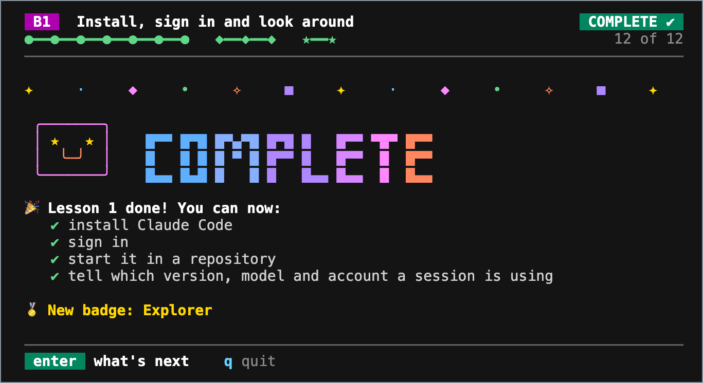

# Claude Code practice

Репозиторий для практики к руководству [Claude Code: Everything You Need to Know](https://github.com/wesammustafa/Claude-Code-Everything-You-Need-to-Know). Уроки лежат в руководстве; в этом репозитории находятся небольшое приложение, на котором вы тренируетесь, и проверка для каждого основного урока и итогового проекта.

<p align="center">
  <!-- Captured from the learning app at template commit 92d427f on 2026-10-11. -->
  
  <br />
  <sub>Учебное приложение, <code>npm run learn</code>, в конце урока 1 начального уровня.</sub>
</p>

## Старт

1. Нажмите **Use this template** > **Create a new repository**, чтобы сделать свою копию, и клонируйте её.
2. Либо откройте свою копию в Codespace: Node.js, Claude Code и зависимости песочницы (sandbox) уже установлены.

Нужны Node.js LTS и git. Через npm ничего устанавливать не надо: приложению и проверкам хватает самого Node.js.

## Учитесь шаг за шагом

Запустите учебное приложение в одном терминале, а Claude Code используйте во втором терминале рядом:

```bash
npm run learn
```

Оно показывает по одному шагу урока, следит за вашей копией и зеленеет, как только ваша работа на месте. Подсказок становится меньше по ходу дела: сначала каждая команда, потом подсказки, потом только цель. В приложении есть все уроки начального уровня и итоговый проект. Начиная с урока 2, каждый урок открывается двумя разминочными вопросами из прошлых уроков и начинается с меньшим числом подсказок, чем предыдущий.

- Клавиши: стрелки или цифры, чтобы выбирать, `enter`, чтобы идти дальше, `h` для подсказки, `m` для карты уроков, `q`, чтобы выйти. Ваше место сохраняется в `.practice/learn.json`.
- Если PowerShell отказывается запускать `npm`, выполните `npm.cmd run learn`.
- Странные символы или цвета? Задайте `LEARN_PLAIN=1` (в PowerShell: `$env:LEARN_PLAIN=1`) перед `npm run learn`. Приложение также учитывает `NO_COLOR`.
- В приложении нет ИИ, и оно не меняет вашу работу: оно читает ваши файлы, запускает `git status` и проверку урока и записывает только свой собственный файл.

## Проверьте свою работу

Каждый основной урок и каждый итоговый проект заканчивается проверкой. Запускайте её из корня своей копии:

```bash
npm run check -- b-1
```

Каждый пункт печатает `PASS` или `FAIL` с подсказкой, что исправить. Чтобы проверить урок, выполненный в одном из ваших собственных репозиториев, выполните ту же команду из своей копии с `--dir` и путём к этому репозиторию, относительным от вашей копии или полным. Здесь это папка рядом с вашей копией:

```bash
npm run check -- b-1 --dir ../my-project
```

Некоторые пункты читают файл, который вы сохраняете в `.practice/`, для состояния, существующего лишь мгновение, например план до его одобрения. Git игнорирует эту папку, поэтому такие пункты проверяются только на вашем компьютере.

## Следите за прогрессом

- Каждый push запускает workflow **Progress**, который выводит результат каждой проверки в сводке запуска. Он никогда не падает: незавершённое упражнение отображается как «пока нет», а пункты, читающие `.practice/`, как «проверено локально».
- Откройте issue по шаблону **Track my progress**, чтобы получить чек-лист по каждому уроку и итоговому проекту.
- В ветке `solutions` [шаблона](https://github.com/wesammustafa/claude-code-practice) лежит эталонное решение для каждой проверки. Читайте его после честной попытки.

## Приложение

Небольшая программа для проверки ссылок в Markdown. Она сообщает об относительных ссылках, файл которых отсутствует:

```bash
npm run linkcheck -- samples
npm test
```

Приложение — это `src/`, `test/` и `samples/`. Остальное относится к курсу: в `checks/` лежат проверки, в `learn/` — пошаговое учебное приложение, в `capstone/` — задания итоговых проектов, в `.github/` — workflows. Workflow **Assert checks** работает только в репозитории шаблона: в вашей копии его задание пропускается, и GitHub показывает это как пропущенную проверку, так что вы можете коммитить упражнения в любую ветку, включая `main`.

## В Codespace

- Dev Container Feature для Claude Code всегда устанавливает последнюю версию Claude Code ([Dev containers](https://code.claude.com/docs/en/devcontainer)). Руководство проверено на релизе `stable`, который совпадает с ней или старше, так что уроки по-прежнему применимы.
- Если вход через браузер завершился, а терминал всё ещё ждёт, скопируйте код, который показывает браузер, и вставьте его на запрос `Paste code here if prompted` ([Dev containers](https://code.claude.com/docs/en/devcontainer)).
- Если команды в песочнице падают с `Can't mount proc on /newroot/proc: Operation not permitted`, контейнер блокирует собственное монтирование `/proc` песочницы. Обойти это можно, задав `sandbox.enableWeakerNestedSandbox` значение `true`, но делайте так, только когда контейнер уже обеспечивает нужную вам изоляцию ([Sandboxing](https://code.claude.com/docs/en/sandboxing)).
- Время вычислений в Codespaces учитывается в включённом лимите вашего аккаунта GitHub ([Codespaces billing](https://docs.github.com/en/billing/concepts/product-billing/github-codespaces)).

## Лицензия

MIT. См. [LICENSE](LICENSE). Claude Code — продукт Anthropic; это независимый проект сообщества, не связанный с Anthropic и не одобренный ею.

Sources: [Dev containers](https://code.claude.com/docs/en/devcontainer), [Sandboxing](https://code.claude.com/docs/en/sandboxing), [Codespaces billing](https://docs.github.com/en/billing/concepts/product-billing/github-codespaces)
